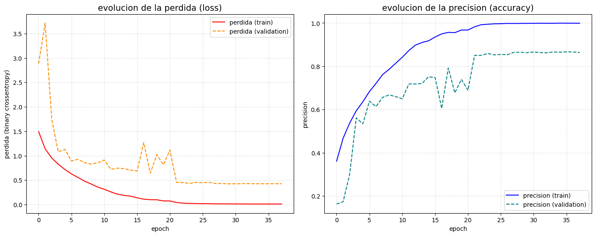
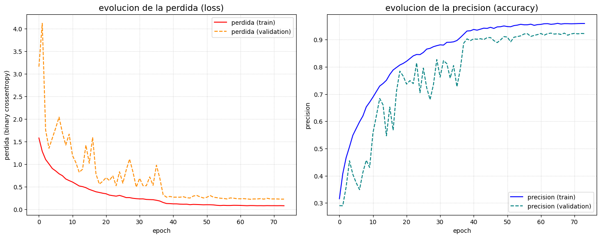

# Clasificación de tipos de vehículo: MLP, CNN y transfer learning

> Comparación experimental de tres enfoques de redes neuronales para clasificar imágenes de vehículos en 7 tipos, desde un perceptrón multicapa hasta MobileNetV2 con fine-tuning, con TensorFlow/Keras.
> Proyecto individual · Grado en Ingeniería Informática · Universidad Carlos III de Madrid (2025–2026)

**Idioma:** [English](./README.md) · Español

[](https://www.python.org/)
[](https://www.tensorflow.org/)

---

## Resultados

| Modelo | Entrada | Exactitud en validación |
| :--- | :--- | :---: |
| Clase mayoritaria (baseline) | — | 29,8 % |
| MLP | 64×64, escala de grises | ≈ 54 % |
| CNN propia, sin augmentation | 128×128, RGB | ≈ 86 % |
| **CNN propia + augmentation + pesos de clase** | 128×128, RGB | **92,4 %** |
| MobileNetV2 (transfer learning + fine-tuning) | 224×224, RGB | 89,6 % |

Las conclusiones principales: las convoluciones suben la exactitud de un 54 % a un 86 % aproximadamente; la data augmentation reduce el sobreajuste y añade unos 6 puntos más; y una CNN pequeña entrenada desde cero (unos 490.000 parámetros) iguala o supera a MobileNetV2 preentrenada en este dataset.

---

## Los datos

Un dataset de Kaggle con **15.645 imágenes de vehículos** en 7 clases desbalanceadas, con una partición 80/20 en entrenamiento (12.516) y validación (3.129). El dataset no se incluye en el repositorio.

| Clase | Imágenes |
| :--- | ---: |
| City Car | 4.657 |
| Multi Purpose Vehicle | 2.649 |
| Sedan | 2.619 |
| Van | 2.167 |
| Sport Utility Vehicle | 1.826 |
| Truck | 1.150 |
| Big Truck | 577 |

La clase mayoritaria tiene 8 veces más imágenes que la minoritaria, así que la pérdida se pondera con la frecuencia inversa de cada clase. Antes de modelar, `analyze_resolutions.py` analiza la distribución de resoluciones de las imágenes para elegir el tamaño de entrada de la red.

---

## Experimentos

**1. MLP de referencia.** La imagen se aplana en un vector, así que los pesos de la primera capa crecen con el tamaño de la entrada. Pasar a escala de grises reduce los pesos de esa capa de 1,57 millones a 524.000. El MLP llega a un 54 % aproximadamente, muy por encima del 29,8 % de la clase mayoritaria pero lejos de ser útil: al aplanar la imagen pierde su estructura espacial.

**2. CNN propia.** Cuatro bloques Conv 3×3 + BatchNorm + MaxPool (de 32 a 256 filtros), global average pooling y un clasificador denso con dropout. Adam, reducción del learning rate al estancarse la validación y early stopping. Sin augmentation sobreajusta mucho: 100 % de exactitud en entrenamiento frente a un 86 % aproximadamente en validación.

**3. CNN propia con augmentation.** Capas de augmentation dentro del modelo (volteo horizontal, rotación de ±11°, traslación y zoom de ±10 %), pesos de clase y más dropout. La exactitud en validación sube al **92,4 %**, y la diferencia con entrenamiento baja de unos 14 a unos 3 puntos.

<table>
<tr>
<td></td>
</tr>
<tr><td align="center">CNN propia sin augmentation: el entrenamiento llega al 100 % mientras la validación se estanca (sobreajuste)</td></tr>
<tr>
<td></td>
</tr>
<tr><td align="center">CNN propia con augmentation: entrenamiento y validación se mantienen cerca</td></tr>
</table>

*El eje de la pérdida en estas gráficas indica por error "binary crossentropy"; la pérdida es en realidad la entropía cruzada categórica (sparse categorical cross-entropy).*

**4. Transfer learning con MobileNetV2** (preentrenada en ImageNet, 224×224), en dos fases: primero se entrena solo la nueva cabeza clasificadora con la base congelada (67 % en validación); después se descongelan las capas superiores de la base (de la 100 en adelante) y se ajustan con un learning rate muy bajo, early stopping y guardado del mejor modelo. Exactitud final en validación: **89,6 %**.

---

## Limitaciones

- **No hay conjunto de test independiente.** La validación se usa también para el early stopping y la reducción del learning rate, así que las cifras son algo optimistas.
- **Solo se mide la exactitud.** Con clases desbalanceadas, la matriz de confusión y el macro-F1 mostrarían cómo se comportan los modelos en clases minoritarias como *Big Truck*.
- **MobileNetV2 usa otra partición** (semilla 123 en lugar de 42), así que su comparación con las CNN es aproximada y la diferencia de 3 puntos no es concluyente.
- **El notebook se ejecutó en varias sesiones.** Algunas salidas proceden de ejecuciones anteriores; cada caso se indica junto a la celda correspondiente.

**Siguientes pasos:** una partición fija train/val/test común a todos los modelos, matriz de confusión y macro-F1 por modelo, y una comparación de fine-tuning más justa con MobileNetV2 o EfficientNet.

---

## Stack tecnológico

Python, TensorFlow/Keras, scikit-learn, NumPy, pandas, Matplotlib, seaborn.

---

## Estructura del repositorio

```
vehicle-type-classification/
├── vehicle_classification.ipynb   # Experimentos: MLP, CNN propia, augmentation y MobileNetV2
├── analyze_resolutions.py         # Análisis de resoluciones para elegir el tamaño de entrada
├── figures/                       # Curvas de entrenamiento
├── requirements.txt
├── README.md
└── README.es.md
```

Para ejecutarlo, instala las dependencias con `pip install -r requirements.txt` y coloca el dataset en `data/archive`, con una carpeta por clase. El notebook usa `model.fit(workers=...)`, que requiere TensorFlow < 2.16.

---

## Autor

**Fernando Martín Arencibia** · [LinkedIn](https://www.linkedin.com/in/fernando-martin-arencibia-477257368/) · [GitHub](https://github.com/fernandomartinarencibia) · [Email](mailto:fernandomartinarencibia@gmail.com)
